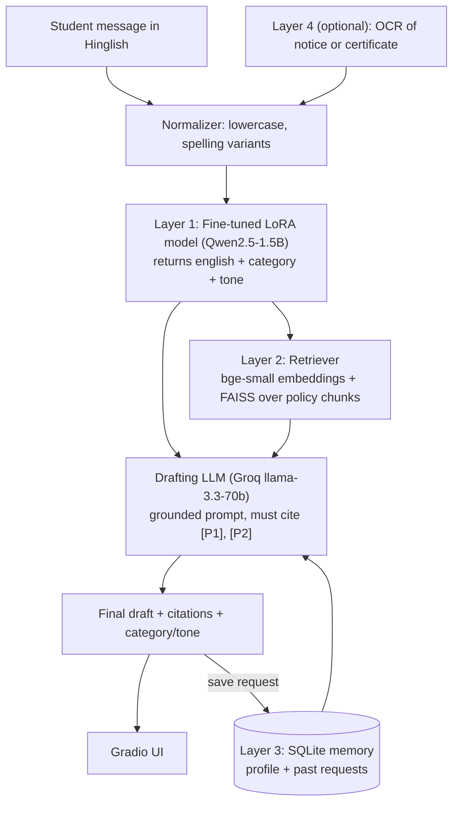

# LexiFlow: Hinglish-to-Formal-English Campus Communication Assistant

> A policy-aware, memory-enabled assistant that turns messy Hinglish student messages into formal English requests, classifies them, grounds them in college rules, and drafts the final email.
> **Everything in this guide runs on free tiers only**: free Colab/Kaggle GPU, Groq free API, GitHub Copilot Free, Hugging Face free hosting.

---

## Table of Contents

1. [What you are building](#1-what-you-are-building)
2. [Free-tier toolbox and constraints](#2-free-tier-toolbox-and-constraints)
3. [Architecture](#3-architecture)
4. [Repository structure](#4-repository-structure)
5. [Environment setup](#5-environment-setup)
6. [Phase 0: Data cleaning and splitting](#6-phase-0-data-cleaning-and-splitting)
7. [Phase 1: Baselines with Groq](#7-phase-1-baselines-with-groq)
8. [Phase 2: LoRA fine-tuning](#8-phase-2-lora-fine-tuning-on-free-gpu)
9. [Phase 3: Evaluation](#9-phase-3-evaluation)
10. [Phase 4: Source grounding (RAG)](#10-phase-4-source-grounding-rag)
11. [Phase 5: Memory](#11-phase-5-memory)
12. [Phase 6: Pipeline, app and deployment](#12-phase-6-pipeline-app-and-deployment)
13. [Phase 7 (optional): Multimodal](#13-phase-7-optional-multimodal)
14. [Free-tier survival guide](#14-free-tier-survival-guide)
15. [4-week timeline and checklist](#15-4-week-timeline-and-checklist)
16. [Portfolio: README, results table, resume bullets](#16-portfolio-readme-results-table-resume-bullets)
17. [Troubleshooting](#17-troubleshooting)

---

## 1. What you are building

**Input** (what a student types):

```
meri attendance 67% hai, kya mujhe condonation mil sakta hai
```

**LexiFlow output:**

```json
{
  "english": "My attendance is 67%. Can I get condonation?",
  "category": "attendance_request",
  "tone": "formal",
  "policy_sources": ["attendance_policy.md#condonation (P1)"],
  "draft_email": "Subject: Request for Attendance Condonation\n\nRespectfully Sir/Madam, ... [P1]"
}
```

### Feature layers (stop at any layer and still have a shippable project)

| Layer | Feature | FYR area covered | Effort |
|---|---|---|---|
| 1 | LoRA fine-tuned small LLM: translate + classify category + tone | Fine-tuning open-source LLMs | 1-2 weeks |
| 2 | RAG over college policy docs, with citations | Source grounding | ~1 week |
| 3 | Per-user memory (name, roll no, past requests) | Assistant with memory | 2-3 days |
| 4 | OCR of notices or medical certificates (optional) | Multimodal | 3-5 days |

**Minimum viable version:** Layers 1 + 2 ("policy-aware Hinglish request drafter").

---

## 2. Free-tier toolbox and constraints

| Need | Tool | Free limit to know |
|---|---|---|
| Code assistant | **GitHub Copilot Free** | Small monthly quota of completions and chat messages (check current numbers in your Copilot settings). Use it for boilerplate and tests, not for whole-file generation every time. |
| Hosted LLM API | **Groq** (`GROQ_API_KEY` env var) | Rate-limited per minute and per day, varies by model. Add retries, caching and sleeps. Check current model IDs at console.groq.com. |
| Training GPU | **Kaggle** (T4 x2 or P100, ~30 GPU hrs/week) or **Google Colab** (T4, session limits) | Sessions time out. Save checkpoints to disk and push to the HF Hub. |
| Model/dataset hosting | **Hugging Face Hub** | Free public repos. |
| Demo hosting | **Hugging Face Spaces** (CPU basic: 2 vCPU, 16 GB RAM) | No GPU. Fine-tuned model must run as a small quantized GGUF, or fall back to Groq. |
| Vector search | **FAISS** (local) | Free, no server. |
| Embeddings | **sentence-transformers** (local, CPU) | Free, small models. |
| Memory store | **SQLite** | Built into Python. |
| Experiment tracking | **Weights & Biases free** or just CSV/JSON logs | Optional. |

### Key design decisions caused by the free tier

1. **Groq cannot host your fine-tuned model.** So Groq is used for: baselines, few-shot comparison, LLM-as-judge, synthetic data augmentation, and the email-drafting step. Your own LoRA model does the translate + classify step (this is your core fine-tuning contribution).
2. **No GPU on the free demo host.** Export the fine-tuned model to a 4-bit GGUF (about 1 GB for a 1.5B model) and run it with `llama-cpp-python` on CPU. Keep a config flag (`TRANSLATOR_BACKEND=local|groq`) so the app still works if the local model fails.
3. **Rate limits.** Every Groq call goes through one wrapper with retry, exponential backoff, and a disk cache.

---

## 3. Architecture



### Component responsibilities

| Component | Input | Output | Tech |
|---|---|---|---|
| Normalizer | raw text | cleaned text | Python regex |
| Translator/Classifier | Hinglish text | JSON `{english, category, tone}` | Qwen2.5-1.5B-Instruct + LoRA (GGUF at inference) |
| Retriever | English text + category | top-k policy chunks with scores | `BAAI/bge-small-en-v1.5` + FAISS |
| Memory | user_id | profile + recent requests | SQLite |
| Drafter | english, category, tone, chunks, profile | formal email with citations | Groq `llama-3.3-70b-versatile` |
| UI | text | rendered result | Gradio |

**Why retrieve on the English translation:** your embeddings model is English, so Layer 1 acts as a "Hinglish to English adapter" for retrieval. This also makes a nice ablation (retrieval on raw Hinglish vs translated English).

---

## 4. Repository structure

```
lexiflow/
├── README.md
├── requirements.txt
├── .env.example                 # GROQ_API_KEY=your_key_here (never commit real keys)
├── .gitignore                   # .env, data/raw, *.gguf, outputs/, __pycache__
├── configs/
│   └── config.yaml              # model names, paths, thresholds
├── data/
│   ├── raw/dataset.jsonl        # your original 2000 examples
│   ├── processed/               # train.jsonl, val.jsonl, test.jsonl
│   └── policies/                # attendance_policy.md, exam_rules.md, leave_policy.md ...
├── notebooks/
│   ├── 01_data_exploration.ipynb
│   ├── 02_finetune_kaggle.ipynb # runs on Kaggle/Colab GPU
│   └── 03_results_analysis.ipynb
├── src/lexiflow/
│   ├── __init__.py
│   ├── data/
│   │   ├── clean.py             # load, normalize, dedupe
│   │   ├── split.py             # template-grouped split
│   │   └── augment.py           # spelling variants + Groq synthetic data
│   ├── llm/
│   │   ├── groq_client.py       # retry + cache wrapper
│   │   └── local_model.py       # GGUF / HF model loader
│   ├── pipeline/
│   │   ├── translator.py        # Layer 1 inference
│   │   ├── retriever.py         # Layer 2
│   │   ├── memory.py            # Layer 3
│   │   ├── drafter.py           # grounded email generation
│   │   └── orchestrator.py      # ties it all together
│   └── eval/
│       ├── metrics.py           # chrF, BLEU, accuracy, macro-F1
│       ├── run_baselines.py
│       ├── run_eval.py
│       └── retrieval_eval.py    # recall@k
├── app/
│   └── app.py                   # Gradio app (also the HF Space entry point)
├── tests/
│   ├── test_clean.py
│   ├── test_split.py
│   └── test_memory.py
└── results/
    ├── results_table.md
    └── error_analysis.md
```

---

## 5. Environment setup

```bash
# 1. Create repo and environment
mkdir lexiflow && cd lexiflow
git init
python -m venv .venv
source .venv/bin/activate            # Windows: .venv\Scripts\activate

# 2. Install dependencies
pip install pandas scikit-learn sacrebleu groq faiss-cpu \
            sentence-transformers gradio pyyaml pytest tqdm \
            llama-cpp-python

# 3. Verify the Groq key is available (it is already set as an env variable)
python -c "import os; print('GROQ_API_KEY set:', bool(os.getenv('GROQ_API_KEY')))"
```

`requirements.txt` (pin versions after everything works: run `pip freeze`):

```
pandas
scikit-learn
sacrebleu
groq
faiss-cpu
sentence-transformers
gradio
pyyaml
pytest
tqdm
llama-cpp-python
```

> Training dependencies (`unsloth`, `trl`, `peft`, `bitsandbytes`, `transformers`) are installed **inside the Kaggle/Colab notebook only**, not in `requirements.txt`, so the demo app stays lightweight.

**Never commit your API key.** Groq's client reads `GROQ_API_KEY` automatically, so no key appears anywhere in code. On Hugging Face Spaces, add it under *Settings → Variables and secrets* with the same name.

**Copilot tip:** put a short `CONTEXT.md`-style comment at the top of files (what the module does, inputs/outputs) so Copilot Free's suggestions are accurate with fewer retries.

---

## 6. Phase 0: Data cleaning and splitting

### 6.1 Known problems in the dataset

| Problem | Why it matters | Fix |
|---|---|---|
| Duplicates (e.g. "Maths ka exam kab hai maam" appears more than once) | Train/test leakage inflates scores | Dedupe exact pairs, then split **by template** |
| Inconsistent honorifics (`sir/maam` sometimes kept, sometimes dropped) | Model learns noise | Pick one convention (below) and normalise |
| Spelling variants of the same word (`mam/maam/ma'am/madam`) | Inconsistent output | Map all to `Ma'am` / `Madam` / `Sir` |
| Gender lost in Hinglish (`sakti hoon`) | Not recoverable in English | Accept; English output is gender-neutral |
| Class imbalance (exam queries dominate) | Poor F1 on small categories | Augment small categories, report macro-F1 |
| Only 2 tones (`formal`, `polite`) | Low tone variety | Optionally add `urgent`, `apologetic` via synthetic data |

### 6.2 Conventions (decide once, document in README)

- If the input contains an honorific, the output **starts with** it: `Sir,` / `Ma'am,` / `Madam,`.
- `mam`, `maam`, `ma'am` → output `Ma'am`.
- Output is always one or two short, complete sentences.
- Category set: `leave_request`, `examination_query`, `complaint_request`, `assignment_query`, `attendance_request`, `deadline_extension`.

### 6.3 `src/lexiflow/data/clean.py`

```python
import json, re
from pathlib import Path

def load_records(path):
    """Robust loader: works for proper JSONL and for objects glued together like '}{'."""
    text = Path(path).read_text(encoding="utf-8")
    dec, idx, out = json.JSONDecoder(), 0, []
    while idx < len(text):
        while idx < len(text) and text[idx].isspace():
            idx += 1
        if idx >= len(text):
            break
        obj, idx = dec.raw_decode(text, idx)
        out.append(obj)
    return out

HONORIFIC_FIX = [
    (r"\b[Mm]a+m\b", "Ma'am"),
    (r"\bMa\u2019am\b", "Ma'am"),
]

def normalize_output(s: str) -> str:
    s = s.strip()
    for pat, rep in HONORIFIC_FIX:
        s = re.sub(pat, rep, s)
    return re.sub(r"\s+", " ", s)

def normalize_input(s: str) -> str:
    return re.sub(r"\s+", " ", s.strip())

def clean(records):
    seen, out = set(), []
    for r in records:
        r = {**r,
             "input": normalize_input(r["input"]),
             "output": normalize_output(r["output"])}
        key = (r["input"].lower(), r["output"].lower())
        if key in seen:
            continue
        seen.add(key)
        out.append(r)
    return out
```

### 6.4 `src/lexiflow/data/split.py` (template-grouped split)

Two messages that differ only by "sir" vs "maam" or "Maths" vs "DSA" are the **same template**. Splitting randomly would put near-copies in train and test.

```python
import re, json
import pandas as pd
from sklearn.model_selection import GroupShuffleSplit

HONORIFICS = r"\b(sir|ma'?am|mam|maam|madam|please|plz|pls|kripya)\b"
SUBJECTS = r"\b(maths?|dsa|os|dbms|java|python|physics|chemistry|computer networks|machine learning|ml)\b"

def template_key(text: str) -> str:
    t = text.lower()
    t = re.sub(HONORIFICS, " ", t)
    t = re.sub(SUBJECTS, "<sub>", t)
    t = re.sub(r"\d+", "<n>", t)
    t = re.sub(r"[^\w<>\s]", " ", t)
    return " ".join(t.split())

def grouped_split(records, seed=42):
    df = pd.DataFrame(records)
    df["group"] = df["input"].map(template_key)
    gss = GroupShuffleSplit(n_splits=1, test_size=0.2, random_state=seed)
    train_idx, rest_idx = next(gss.split(df, groups=df["group"]))
    train, rest = df.iloc[train_idx], df.iloc[rest_idx]
    gss2 = GroupShuffleSplit(n_splits=1, test_size=0.5, random_state=seed)
    val_idx, test_idx = next(gss2.split(rest, groups=rest["group"]))
    return train, rest.iloc[val_idx], rest.iloc[test_idx]

if __name__ == "__main__":
    from lexiflow.data.clean import load_records, clean
    recs = clean(load_records("data/raw/dataset.jsonl"))
    tr, va, te = grouped_split(recs)
    for name, d in [("train", tr), ("val", va), ("test", te)]:
        d.drop(columns=["group"]).to_json(f"data/processed/{name}.jsonl",
                                          orient="records", lines=True, force_ascii=False)
        print(name, len(d), d["category"].value_counts().to_dict())
```

**Sanity check:** assert that no `group` appears in more than one split. Put that in `tests/test_split.py`.

### 6.5 `src/lexiflow/data/augment.py` (realistic noise)

Real students write `kab/kb`, `hai/h`, `nahi/nhi`, `kya/kia`, drop vowels, and skip punctuation. Add noisy variants to **train only** (never to test, or keep a separate "noisy test" set to measure robustness).

```python
import random, re

VARIANTS = {
    "kab": ["kab", "kb"], "hai": ["hai", "h", "hy"], "nahi": ["nahi", "nhi", "nahin"],
    "kya": ["kya", "kia", "kyaa"], "kaam": ["kaam", "kam"], "please": ["please", "plz", "pls"],
    "mujhe": ["mujhe", "mjhe", "mujhko"], "karna": ["karna", "krna"], "sakte": ["sakte", "skte"],
    "kitne": ["kitne", "ktne"], "bata": ["bata", "bta"], "dijiye": ["dijiye", "dijiye", "dijye"],
}

def noisy(text: str, p=0.5, rng=random) -> str:
    out = []
    for w in text.split():
        base = re.sub(r"[^\w']", "", w.lower())
        if base in VARIANTS and rng.random() < p:
            out.append(rng.choice(VARIANTS[base]))
        else:
            out.append(w)
    t = " ".join(out)
    if rng.random() < 0.3:
        t = t.lower()
    return t
```

### 6.6 Synthetic data from Groq (to fix class imbalance)

Use the Groq 70B model to write new Hinglish examples for **under-represented categories and tones**. Always generate JSON, then dedupe and **manually spot-check about 50 samples** before adding to train.

```
Prompt template:
You write realistic Hinglish (Roman-script Hindi + English) messages that Indian college
students send to faculty. Generate 10 NEW examples for category="{category}", tone="{tone}".
Vary subjects (DSA, OS, DBMS, Maths...), honorifics (Sir, Ma'am, Madam) and spelling.
Return JSON: {"examples":[{"input": "...", "output": "<formal English>", "category": "...", "tone": "..."}]}
```

Keep synthetic data **clearly flagged** (`"source": "synthetic"`) so you can report results with and without it.

---

## 7. Phase 1: Baselines with Groq

You need baselines to prove fine-tuning helped. Three comparisons:

| System | What it is |
|---|---|
| B0 | Zero-shot Groq `llama-3.1-8b-instant` |
| B1 | Few-shot (k=5 nearest train examples) Groq `llama-3.1-8b-instant` |
| B2 | Zero-shot or few-shot Groq `llama-3.3-70b-versatile` (a strong ceiling) |
| **Ours** | Fine-tuned Qwen2.5-1.5B (about 1.5B params) |

The headline story: *"A 1.5B model fine-tuned on 1.6k examples matches or beats prompted 8B/70B models, and runs on a CPU."* (Report the truth, whatever the numbers turn out to be.)

### 7.1 `src/lexiflow/llm/groq_client.py` (retry + cache)

```python
import os, json, time, hashlib
from pathlib import Path
from groq import Groq

_client = Groq()  # reads GROQ_API_KEY from the environment
CACHE = Path(".cache/groq.jsonl")
CACHE.parent.mkdir(exist_ok=True)
_cache = {}
if CACHE.exists():
    for line in CACHE.read_text(encoding="utf-8").splitlines():
        d = json.loads(line)
        _cache[d["k"]] = d["v"]

def chat(messages, model="llama-3.1-8b-instant", json_mode=False,
         temperature=0.0, max_tokens=400, retries=6):
    key = hashlib.sha256(json.dumps([messages, model, json_mode, temperature],
                                    sort_keys=True).encode()).hexdigest()
    if key in _cache:
        return _cache[key]
    kwargs = dict(model=model, messages=messages, temperature=temperature, max_tokens=max_tokens)
    if json_mode:
        kwargs["response_format"] = {"type": "json_object"}
    for i in range(retries):
        try:
            out = _client.chat.completions.create(**kwargs).choices[0].message.content
            _cache[key] = out
            with CACHE.open("a", encoding="utf-8") as f:
                f.write(json.dumps({"k": key, "v": out}, ensure_ascii=False) + "\n")
            time.sleep(0.5)                    # gentle pacing for free-tier limits
            return out
        except Exception as e:                 # 429s, timeouts
            time.sleep(min(2 ** i, 60))
    return None
```

### 7.2 Baseline prompt

```python
SYSTEM = """You convert Hinglish (Roman Hindi + English) student messages into formal English
for a college setting. Return ONLY JSON: {"english": str, "category": one of
[leave_request, examination_query, complaint_request, assignment_query,
attendance_request, deadline_extension], "tone": one of [formal, polite]}.
If an honorific (Sir/Ma'am/Madam) is present, start the English sentence with it."""
```

For few-shot (B1), pick the 5 nearest training examples with TF-IDF over character n-grams (no model downloads needed):

```python
from sklearn.feature_extraction.text import TfidfVectorizer
from sklearn.metrics.pairwise import cosine_similarity

vec = TfidfVectorizer(analyzer="char_wb", ngram_range=(2, 4)).fit(train_inputs)
train_mat = vec.transform(train_inputs)

def nearest(query, k=5):
    sims = cosine_similarity(vec.transform([query]), train_mat)[0]
    return sims.argsort()[::-1][:k]
```

Run baselines over the **test set only** (a few hundred rows: comfortably inside free limits when cached). Save predictions to `results/preds_{system}.jsonl`.

---

## 8. Phase 2: LoRA fine-tuning on free GPU

### 8.1 Model choice

| Model | Size | Notes |
|---|---|---|
| **Qwen2.5-1.5B-Instruct** (recommended) | 1.5B | Good multilingual ability, trains fast on a T4 |
| Gemma-2-2B-it | 2B | Slightly heavier, also fine |
| mT5-small/base or NLLB-200-distilled-600M | 0.3-0.6B | Seq2seq alternative; handles translation well but classification needs extra heads or text labels |

### 8.2 Training data format

Each example becomes a chat turn. The assistant answer is the JSON string:

```python
SYSTEM = "Convert the Hinglish campus message to formal English and label it. Return JSON only."

def to_messages(r):
    return {"messages": [
        {"role": "system", "content": SYSTEM},
        {"role": "user", "content": r["input"]},
        {"role": "assistant", "content": json.dumps(
            {"english": r["output"], "category": r["category"], "tone": r["tone"]},
            ensure_ascii=False)},
    ]}
```

### 8.3 Notebook (`notebooks/02_finetune_kaggle.ipynb`)

Upload `data/processed/train.jsonl` and `val.jsonl` as a Kaggle dataset (or to Drive for Colab). Turn on **GPU T4**.

```python
# Cell 1: install (Kaggle/Colab only)
!pip install -q unsloth trl peft bitsandbytes datasets

# Cell 2: load model in 4-bit
from unsloth import FastLanguageModel
model, tokenizer = FastLanguageModel.from_pretrained(
    model_name="unsloth/Qwen2.5-1.5B-Instruct",
    max_seq_length=256,          # your examples are short
    load_in_4bit=True,
)

# Cell 3: attach LoRA
model = FastLanguageModel.get_peft_model(
    model, r=16, lora_alpha=32, lora_dropout=0.0,
    target_modules=["q_proj","k_proj","v_proj","o_proj","gate_proj","up_proj","down_proj"],
    use_gradient_checkpointing="unsloth", random_state=42,
)

# Cell 4: dataset -> text using the chat template
from datasets import load_dataset
ds = load_dataset("json", data_files={"train": "train.jsonl", "validation": "val.jsonl"})
ds = ds.map(lambda r: to_messages(r))
ds = ds.map(lambda r: {"text": tokenizer.apply_chat_template(r["messages"], tokenize=False)})

# Cell 5: train
from trl import SFTTrainer, SFTConfig
trainer = SFTTrainer(
    model=model, tokenizer=tokenizer,
    train_dataset=ds["train"], eval_dataset=ds["validation"],
    args=SFTConfig(
        dataset_text_field="text", max_seq_length=256,
        per_device_train_batch_size=16, gradient_accumulation_steps=2,
        num_train_epochs=3, learning_rate=2e-4, lr_scheduler_type="cosine",
        warmup_ratio=0.05, logging_steps=10, eval_strategy="epoch",
        save_strategy="epoch", fp16=True, output_dir="outputs", report_to="none",
    ),
)
trainer.train()

# Cell 6: save adapter and push to the Hub (create a free HF token first)
model.save_pretrained("lexiflow-lora"); tokenizer.save_pretrained("lexiflow-lora")
model.push_to_hub("YOUR_HF_USERNAME/lexiflow-qwen1.5b-lora", token=HF_TOKEN)

# Cell 7: export a 4-bit GGUF for CPU inference in the demo
model.save_pretrained_gguf("lexiflow-gguf", tokenizer, quantization_method="q4_k_m")
```

> **API drift warning:** `trl`/`unsloth` argument names change between versions (e.g. `tokenizer=` vs `processing_class=`, `max_seq_length` placement). If a cell errors, read the error and check the current Unsloth notebook for Qwen2.5 and adjust. Copilot Chat's free quota is good for this kind of "fix this traceback" task.

### 8.4 Training tips

- Compute loss on **assistant tokens only** if your trainer version supports it (`train_on_responses_only` in Unsloth). It usually improves results.
- Start with 1 epoch on 500 examples to validate the pipeline in minutes, then run the full job.
- Track val loss; if it rises while train loss falls, cut epochs to 2.
- Run **ablations** (each is a short job): (a) with vs without augmentation, (b) LoRA r = 8 vs 16 vs 32, (c) 1.5B vs 0.5B model. These make the write-up much stronger.
- Always save to the HF Hub at the end of a run. Free sessions disappear.

---

## 9. Phase 3: Evaluation

### 9.1 Metrics

| Task | Metrics |
|---|---|
| Translation quality | chrF (primary), BLEU, exact-match % |
| Category | accuracy, macro-F1, confusion matrix |
| Tone | accuracy, macro-F1 |
| Format reliability | % of outputs that parse as valid JSON |
| Optional | LLM-as-judge (Groq 70B) scoring adequacy and formality 1-5 on 100 samples |

### 9.2 `src/lexiflow/eval/metrics.py`

```python
import json
import sacrebleu
from sklearn.metrics import accuracy_score, f1_score

def parse(s):
    try:
        d = json.loads(s)
        return d.get("english", ""), d.get("category", "INVALID"), d.get("tone", "INVALID"), True
    except Exception:
        return "", "INVALID", "INVALID", False

def evaluate(raw_outputs, golds):
    """raw_outputs: list[str] model outputs; golds: list[dict] with output/category/tone."""
    parsed = [parse(o) for o in raw_outputs]
    hyp = [p[0] for p in parsed]
    ref = [g["output"] for g in golds]
    return {
        "chrF": round(sacrebleu.corpus_chrf(hyp, [ref]).score, 2),
        "BLEU": round(sacrebleu.corpus_bleu(hyp, [ref]).score, 2),
        "exact_match": round(sum(h.strip().lower() == r.strip().lower() for h, r in zip(hyp, ref)) / len(ref) * 100, 1),
        "cat_acc": round(accuracy_score([g["category"] for g in golds], [p[1] for p in parsed]) * 100, 1),
        "cat_macroF1": round(f1_score([g["category"] for g in golds], [p[1] for p in parsed], average="macro") * 100, 1),
        "tone_acc": round(accuracy_score([g["tone"] for g in golds], [p[2] for p in parsed]) * 100, 1),
        "valid_json_%": round(sum(p[3] for p in parsed) / len(parsed) * 100, 1),
    }
```

### 9.3 Results table to produce (fill with your real numbers)

| System | Params | chrF | BLEU | Cat. acc | Cat. macro-F1 | Tone acc | Valid JSON |
|---|---|---|---|---|---|---|---|
| Zero-shot Llama-3.1-8B (Groq) | 8B | | | | | | |
| Few-shot (k=5) Llama-3.1-8B | 8B | | | | | | |
| Few-shot Llama-3.3-70B | 70B | | | | | | |
| **LexiFlow LoRA (Qwen2.5-1.5B)** | 1.5B | | | | | | |
| LexiFlow + augmentation | 1.5B | | | | | | |

Also evaluate on a **noisy test set** (apply `noisy()` to test inputs) to show robustness.

### 9.4 Error analysis (this is what impresses reviewers)

Manually read 50 wrong predictions and write `results/error_analysis.md`. Group errors: honorific dropped, wrong category (e.g. `deadline_extension` vs `assignment_query`), subject names mistranslated, tone ambiguity. Add 3-5 examples to the README.

---

## 10. Phase 4: Source grounding (RAG)

### 10.1 Build the policy knowledge base

Create 4-6 short Markdown files in `data/policies/`. Use your real college handbook if allowed. Otherwise write **sample policies** and label them clearly:

```markdown
<!-- data/policies/attendance_policy.md -->
# Attendance Policy (SAMPLE, not official)
## Minimum attendance
Students must maintain at least 75% attendance in each subject to be eligible for the end-semester exam.
## Condonation
Students with attendance between 65% and 75% may apply for condonation with a valid reason
(medical certificate or official duty letter). Condonation is approved by the Head of Department.
```

Suggested files: `attendance_policy.md`, `exam_rules.md`, `reexam_policy.md`, `leave_procedure.md`, `assignment_deadlines.md`, `grievance_redressal.md`. Each ~200-400 words, with clear `##` headings.

> Put a visible banner in the app: *"Policies are sample documents for demonstration."* This keeps the project honest.

### 10.2 `src/lexiflow/pipeline/retriever.py`

```python
import re, glob, os
import numpy as np, faiss
from sentence_transformers import SentenceTransformer

class PolicyRetriever:
    def __init__(self, policy_dir="data/policies", model="BAAI/bge-small-en-v1.5"):
        self.model = SentenceTransformer(model)
        self.chunks = self._load_chunks(policy_dir)
        emb = self.model.encode([c["text"] for c in self.chunks],
                                normalize_embeddings=True, convert_to_numpy=True)
        self.index = faiss.IndexFlatIP(emb.shape[1])
        self.index.add(emb.astype("float32"))

    @staticmethod
    def _load_chunks(policy_dir):
        chunks = []
        for path in sorted(glob.glob(os.path.join(policy_dir, "*.md"))):
            doc = os.path.basename(path)
            text = open(path, encoding="utf-8").read()
            title = text.splitlines()[0].lstrip("# ").strip()
            # split on '## ' headings -> one chunk per section
            for sec in re.split(r"\n(?=## )", text)[1:]:
                head, _, body = sec.partition("\n")
                chunks.append({"doc": doc, "section": head.lstrip("# ").strip(),
                               "text": f"{title} - {head.lstrip('# ').strip()}: {body.strip()}"})
        return chunks

    def search(self, query, k=3, min_score=0.45):
        q = self.model.encode([query], normalize_embeddings=True).astype("float32")
        scores, ids = self.index.search(q, k)
        hits = []
        for s, i in zip(scores[0], ids[0]):
            if i >= 0 and s >= min_score:
                c = self.chunks[i]
                hits.append({**c, "score": float(s)})
        return hits
```

Tune `min_score` on your own queries. If nothing passes the threshold, the drafter must say **"No matching policy found"** rather than invent a rule.

### 10.3 `src/lexiflow/pipeline/drafter.py` (grounded generation)

```python
from lexiflow.llm.groq_client import chat

DRAFT_SYSTEM = """You draft formal emails from a college student to faculty.
RULES:
- Use ONLY the policy excerpts provided. Cite each policy you rely on as [P1], [P2].
- If no excerpts are provided, or they do not answer the request, say so and do not invent rules.
- Use the student's profile details when available. Never make up names or roll numbers.
- Keep the email under 150 words. Include a Subject line.
- Match the requested tone."""

def draft(english, category, tone, hits, profile):
    ctx = "\n".join(f"[P{i+1}] ({h['doc']} / {h['section']}) {h['text']}" for i, h in enumerate(hits)) \
          or "NO POLICY EXCERPTS FOUND"
    user = (f"Student request (English): {english}\nCategory: {category}\nTone: {tone}\n"
            f"Student profile: {profile}\n\nPolicy excerpts:\n{ctx}")
    return chat([{"role": "system", "content": DRAFT_SYSTEM},
                 {"role": "user", "content": user}],
                model="llama-3.3-70b-versatile", temperature=0.2, max_tokens=350)
```

### 10.4 Retrieval evaluation

Write 30-40 test queries by hand, each mapped to the correct policy section. Report **recall@1 and recall@3**. Ablate:

1. Retrieve using raw Hinglish vs. LexiFlow's English translation (shows Layer 1 helps Layer 2).
2. With vs. without a category filter or boost.

### 10.5 Faithfulness check

Sample 30 drafts and check by hand (or with a Groq judge prompt): does every claim have a citation, and is every citation supported by its excerpt? Report a "citation-supported %".

---

## 11. Phase 5: Memory

A small SQLite store is enough and fits the free tier perfectly.

### 11.1 Schema and code: `src/lexiflow/pipeline/memory.py`

```python
import sqlite3, json, time

class Memory:
    def __init__(self, path="lexiflow.db"):
        self.db = sqlite3.connect(path, check_same_thread=False)
        self.db.executescript("""
        CREATE TABLE IF NOT EXISTS users(
            user_id TEXT PRIMARY KEY, name TEXT, roll_no TEXT, section TEXT, subjects TEXT);
        CREATE TABLE IF NOT EXISTS requests(
            id INTEGER PRIMARY KEY AUTOINCREMENT, user_id TEXT, ts REAL,
            hinglish TEXT, english TEXT, category TEXT, tone TEXT, draft TEXT);
        """)

    def upsert_profile(self, user_id, name="", roll_no="", section="", subjects=()):
        self.db.execute("""INSERT INTO users VALUES(?,?,?,?,?)
            ON CONFLICT(user_id) DO UPDATE SET name=excluded.name, roll_no=excluded.roll_no,
            section=excluded.section, subjects=excluded.subjects""",
            (user_id, name, roll_no, section, json.dumps(list(subjects))))
        self.db.commit()

    def profile(self, user_id):
        r = self.db.execute("SELECT name, roll_no, section, subjects FROM users WHERE user_id=?",
                            (user_id,)).fetchone()
        return {"name": r[0], "roll_no": r[1], "section": r[2], "subjects": json.loads(r[3])} if r else {}

    def log_request(self, user_id, hinglish, english, category, tone, draft):
        self.db.execute("INSERT INTO requests(user_id, ts, hinglish, english, category, tone, draft) "
                        "VALUES(?,?,?,?,?,?,?)",
                        (user_id, time.time(), hinglish, english, category, tone, draft))
        self.db.commit()

    def recent(self, user_id, category=None, limit=3):
        q = "SELECT ts, english, category FROM requests WHERE user_id=?"
        args = [user_id]
        if category:
            q += " AND category=?"; args.append(category)
        q += " ORDER BY ts DESC LIMIT ?"; args.append(limit)
        return self.db.execute(q, args).fetchall()
```

### 11.2 How memory is used

- **Auto-fill:** the draft includes the name and roll number automatically.
- **Context-aware replies:** "You already requested leave on 12 Oct. Do you want to reference that?" (query `recent(user_id, category="leave_request")`).
- **Duplicate warning:** if the same category and a very similar request was made in the last 24 hours, warn the user.
- **Subject resolution:** if the user says "DSA ka exam", memory confirms DSA is one of their subjects.

### 11.3 Privacy notes (put these in the README)

- Demo users are fake profiles; do not collect real roll numbers in the public Space.
- Provide a "Delete my data" button.
- Do not log real API keys or personal data in the cache files; add `.cache/` and `*.db` to `.gitignore`.

---

## 12. Phase 6: Pipeline, app and deployment

### 12.1 `src/lexiflow/pipeline/translator.py` (Layer 1 inference with fallback)

```python
import os, json
from lexiflow.llm.groq_client import chat

BACKEND = os.getenv("TRANSLATOR_BACKEND", "local")   # local | groq
SYSTEM = "Convert the Hinglish campus message to formal English and label it. Return JSON only."

_llm = None
def _local():
    global _llm
    if _llm is None:
        from llama_cpp import Llama
        _llm = Llama(model_path=os.getenv("GGUF_PATH", "models/lexiflow-q4_k_m.gguf"),
                     n_ctx=512, n_threads=2, verbose=False)
    return _llm

def translate(text: str) -> dict:
    msgs = [{"role": "system", "content": SYSTEM}, {"role": "user", "content": text}]
    try:
        if BACKEND == "local":
            out = _local().create_chat_completion(messages=msgs, temperature=0.0, max_tokens=160)
            raw = out["choices"][0]["message"]["content"]
        else:
            raw = chat(msgs, model="llama-3.1-8b-instant", json_mode=True)
        return json.loads(raw)
    except Exception:
        raw = chat(msgs, model="llama-3.1-8b-instant", json_mode=True)   # safety net
        return json.loads(raw)
```

Download the GGUF from your HF repo at Space startup with `huggingface_hub.hf_hub_download`.

### 12.2 `src/lexiflow/pipeline/orchestrator.py`

```python
from lexiflow.pipeline.translator import translate
from lexiflow.pipeline.retriever import PolicyRetriever
from lexiflow.pipeline.memory import Memory
from lexiflow.pipeline.drafter import draft

class LexiFlow:
    def __init__(self):
        self.retriever = PolicyRetriever()
        self.memory = Memory()

    def run(self, user_id: str, hinglish: str) -> dict:
        t = translate(hinglish)                                     # Layer 1
        hits = self.retriever.search(t["english"], k=3)             # Layer 2
        profile = self.memory.profile(user_id)                      # Layer 3
        past = self.memory.recent(user_id, category=t["category"])
        email = draft(t["english"], t["category"], t["tone"], hits,
                      {**profile, "past_similar_requests": past})
        self.memory.log_request(user_id, hinglish, t["english"], t["category"], t["tone"], email)
        return {**t, "sources": hits, "draft": email, "past": past}
```

### 12.3 `app/app.py` (Gradio)

```python
import gradio as gr
from lexiflow.pipeline.orchestrator import LexiFlow

app = LexiFlow()

def process(user_id, name, roll, text):
    if name or roll:
        app.memory.upsert_profile(user_id, name=name, roll_no=roll)
    r = app.run(user_id, text)
    sources = "\n".join(f"**[P{i+1}]** {h['doc']} / {h['section']} (score {h['score']:.2f})"
                        for i, h in enumerate(r["sources"])) or "No matching policy found."
    return r["english"], f"{r['category']} | {r['tone']}", r["draft"], sources

with gr.Blocks(title="LexiFlow") as demo:
    gr.Markdown("# LexiFlow\nHinglish → formal English, grounded in (sample) college policies.\n"
                "*Policies shown are sample documents for demonstration.*")
    with gr.Row():
        uid = gr.Textbox(label="User ID (demo)", value="demo_user")
        name = gr.Textbox(label="Name (optional)")
        roll = gr.Textbox(label="Roll no. (optional, use a fake one)")
    inp = gr.Textbox(label="Your message (Hinglish)", lines=3,
                     placeholder="meri attendance 67% hai, kya mujhe condonation mil sakta hai")
    btn = gr.Button("Generate")
    eng = gr.Textbox(label="Formal English"); lab = gr.Textbox(label="Category | Tone")
    email = gr.Textbox(label="Draft email", lines=8); src = gr.Markdown(label="Sources")
    btn.click(process, [uid, name, roll, inp], [eng, lab, email, src])
    gr.Examples(["sir mujhe 3 din ki leave chahiye, tabiyat kharab hai",
                 "maam DBMS assignment ki deadline badha dijiye plz",
                 "mera OS ka exam miss ho gaya, re-exam hoga kya"], inp)

if __name__ == "__main__":
    demo.launch()
```

### 12.4 Deploying to Hugging Face Spaces (free)

1. Create a **Space → Gradio → CPU basic**.
2. Push the repo (or just `app/`, `src/`, `data/policies/`, `requirements.txt`).
3. Rename `app/app.py` to `app.py` at the root, or set `app_file` in the README front-matter.
4. Add secret `GROQ_API_KEY` under *Settings → Variables and secrets*.
5. Add a variable `TRANSLATOR_BACKEND=local` (or `groq` if the GGUF is too slow).
6. Download the GGUF at startup via `hf_hub_download(repo_id="YOUR_USER/lexiflow-gguf", filename="...gguf")`.
7. Free Spaces sleep when idle. Mention a cold-start warning in the README.

Also publish: the **model** (LoRA adapter + GGUF) and the **cleaned dataset** (if you own the rights to share it) as separate HF repos with model cards / dataset cards.

---

## 13. Phase 7 (optional): Multimodal

Only start this when Layers 1-3 are finished and written up.

**Goal:** the student uploads a photo of a notice or medical certificate; LexiFlow extracts the text and drafts the related request.

| Option | Cost | Notes |
|---|---|---|
| **Tesseract OCR** (`pytesseract`) | free, local | Good for printed text; English + Hindi (`hin`) language packs |
| **EasyOCR** | free, local | Better on photos; heavier on CPU |
| **Groq vision model** | free tier | Check whether a vision-capable model is currently listed; availability changes |

Flow: `image → OCR → extract key fields (dates, doctor name, notice subject) → feed as context to drafter`. Example: certificate says "rest advised 12-14 Oct" → the leave email auto-fills the dates.

Evaluate honestly on 20-30 photos you collect yourself (fake or sample documents only; never upload real medical records publicly).

---

## 14. Free-tier survival guide

### Groq

- Every call goes through `groq_client.chat()` (retry, backoff, disk cache).
- Develop on `llama-3.1-8b-instant` (higher limits); use the 70B only for final drafting and the final eval run.
- Cache everything. Re-running evals should cost zero API calls.
- If you hit daily limits, switch the translator backend to `local` and wait for reset.
- Model IDs change over time. Check the current list at console.groq.com/docs/models and keep model names in `configs/config.yaml`, not hard-coded.

### Kaggle / Colab

- Save work to the HF Hub after every training run.
- Colab: keep the tab active, mount Drive for checkpoints.
- Kaggle: enable GPU in *Settings → Accelerator*; weekly quota is limited, so debug on a tiny subset first.
- Don't waste GPU time: preprocess data on your laptop, upload only the final JSONL files.

### GitHub Copilot Free

- Use **inline completions** for boilerplate (loops, pandas, Gradio layout).
- Save **Chat** messages for: debugging tracebacks, writing unit tests, docstrings.
- Write clear function signatures and docstrings first; completions get far better.
- Don't ask Copilot to design the architecture; this document already does that.

### Hugging Face Spaces

- CPU only, so quantize (GGUF Q4_K_M) and keep `n_ctx` small.
- Keep the repo under free storage limits: store the GGUF in a separate model repo.
- Set a request timeout and show a spinner in the UI.

---

## 15. 4-week timeline and checklist

### Week 1: Data + baselines
- [ ] Repo, venv, `.gitignore`, `.env.example`
- [ ] Load and clean dataset; document conventions
- [ ] Template-grouped train/val/test split + leakage test
- [ ] Data exploration notebook (category/tone counts, length stats)
- [ ] Groq wrapper with cache and retry
- [ ] Baselines B0, B1 (and B2 if limits allow) + `metrics.py`
- [ ] First row of the results table

### Week 2: Fine-tuning
- [ ] Augmentation (`noisy()`) + optional synthetic data (flagged, spot-checked)
- [ ] Kaggle notebook: LoRA training, push adapter to HF
- [ ] Evaluate on clean + noisy test sets
- [ ] 2-3 ablations (augmentation, LoRA rank, model size)
- [ ] Error analysis (50 samples)
- [ ] Export GGUF and test CPU inference locally

### Week 3: RAG + memory
- [ ] Write 4-6 sample policy docs
- [ ] Retriever (bge-small + FAISS) + recall@k eval on 30+ queries
- [ ] Grounded drafter with citations + "no policy found" behaviour
- [ ] SQLite memory + auto-fill + duplicate warning
- [ ] Orchestrator + unit tests (memory, splitting, cleaning)

### Week 4: Demo + write-up
- [ ] Gradio app, test with 15+ messy inputs
- [ ] Deploy to HF Spaces (with Groq fallback)
- [ ] README with architecture diagram, results table, limitations
- [ ] Model card and dataset card on HF
- [ ] 2-minute demo video or GIF
- [ ] LinkedIn/GitHub write-up

---

## 16. Portfolio: README, results table, resume bullets

### README outline

1. One-line pitch + demo GIF + live Space link
2. Problem: why Hinglish → formal English matters for students
3. Architecture diagram (the mermaid chart above)
4. Quickstart (`pip install`, set `GROQ_API_KEY`, run `app/app.py`)
5. Dataset: size, categories, cleaning steps, split method (template-grouped), license note
6. Results table + ablations + noisy-test results
7. RAG: policy docs, retrieval recall@k, faithfulness check
8. Memory design and privacy notes
9. Limitations (small dataset, sample policies, 2 tones only, gender-neutral output, free-tier latency)
10. Future work (more tones, more languages like Hinglish ↔ Punjabi/Bengali-English mixes, multimodal, official policy integration)

### Resume bullets (edit with real numbers)

- Fine-tuned Qwen2.5-1.5B with QLoRA on a cleaned Hinglish→formal-English dataset (N examples), reaching X chrF and Y% category accuracy, outperforming prompted Llama-3.1-8B (X vs. Y) while running on CPU.
- Designed a template-grouped evaluation split that removed train/test leakage, exposing a Z-point drop versus random splits.
- Built a policy-grounded RAG layer (bge-small + FAISS) with cited drafts and a no-answer fallback; recall@3 = X, citation-supported drafts = Y%.
- Implemented SQLite-based user memory for auto-filled, context-aware drafts; deployed end-to-end demo on Hugging Face Spaces using free-tier infrastructure.

---

## 17. Troubleshooting

| Symptom | Likely cause | Fix |
|---|---|---|
| `groq.AuthenticationError` | env var not visible to the process | Restart terminal/IDE after setting `GROQ_API_KEY`; on Spaces use a Secret |
| `429 Too Many Requests` | free-tier rate limit | Rely on the cache; increase sleep; use the 8B model while developing |
| JSON parse failures from the fine-tuned model | too few epochs, or loss computed on prompt tokens too | More epochs, `train_on_responses_only`, lower temperature to 0; add a JSON repair/regex fallback |
| Test scores suspiciously high (>95%) | template leakage | Recheck grouped split; look for near-duplicates across splits |
| Model always predicts `examination_query` | class imbalance | Class-balanced sampling, augment small classes, report macro-F1 |
| CUDA OOM on T4 | batch too large | Lower `per_device_train_batch_size`, raise gradient accumulation, keep `max_seq_length=256` |
| Space build fails on `llama-cpp-python` | needs compiling | Pin a version with a prebuilt CPU wheel, or set `TRANSLATOR_BACKEND=groq` |
| Retrieval returns wrong policy | threshold or chunking | Check chunk text, tune `min_score`, retrieve on the English translation, add a category boost |
| Drafts invent rules | grounding prompt too weak | Enforce "use only excerpts"; return "no policy found" when `hits` is empty; add the faithfulness check |

---

### Suggested order of work (TL;DR)

1. **Clean + split** the data (template-grouped).
2. **Baselines** with Groq → first results table.
3. **LoRA fine-tune** on Kaggle → beat or match baselines with a small model.
4. **RAG** with sample policy docs → cited drafts.
5. **Memory** with SQLite → auto-filled, context-aware drafts.
6. **Gradio app** on HF Spaces → README + write-up.
7. Optional: OCR multimodal layer.
