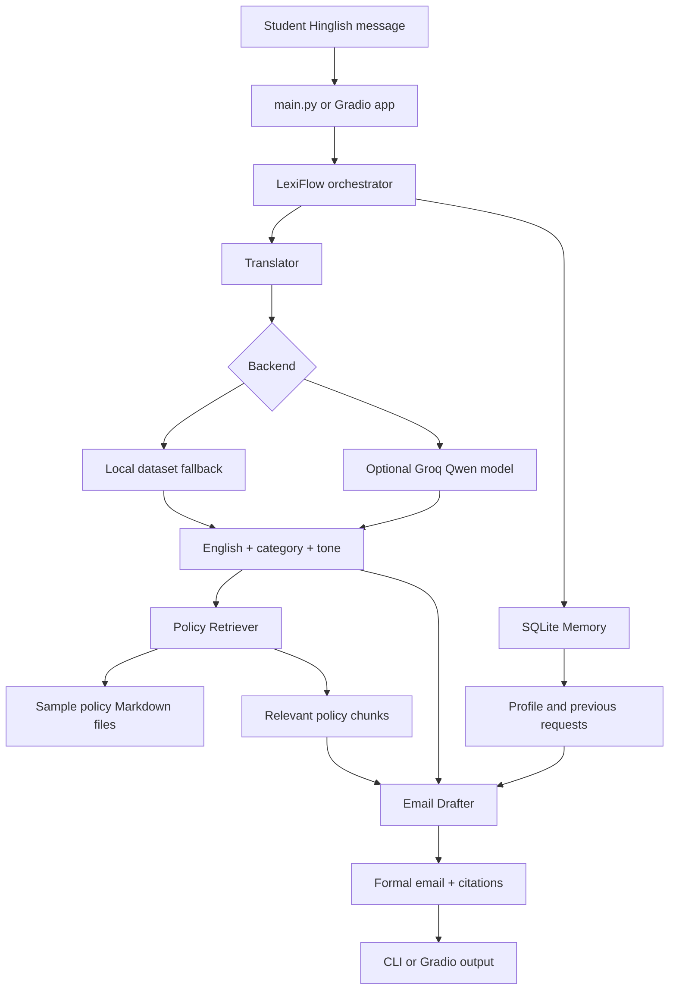

# LexiFlow Architecture and Project Explanation

## 1. Project Summary

LexiFlow is a campus communication assistant for students. It accepts an informal Romanized Hindi-English message, converts it into formal English, classifies the request, searches sample college-policy documents, remembers the demo user's previous requests, and produces a formal email draft.

Example input:

```text
meri attendance 67% hai, kya mujhe condonation mil sakta hai
```

Example result:

```text
English: My attendance is 67%. Can I get condonation?
Category: attendance_request | Tone: formal
```

The project currently works as an offline MVP. It also has an optional Groq backend for stronger language generation.

## 2. Problem Being Solved

Students often write messages in Romanized Hinglish and informal shorthand. These messages may be understandable to a friend but unsuitable for a professor or college administration.

LexiFlow solves four related problems:

1. Converts informal Hinglish into formal English.
2. Identifies the intent of the message.
3. Finds relevant information in college policy documents.
4. Creates a professional email draft that can be sent to faculty or administration.

The system is designed for messages about attendance, leave, examinations, assignments, deadlines, and campus problems.

## 3. Current Features

The implemented MVP includes:

- Hinglish input validation and normalization.
- Translation using the local dataset-based fallback.
- Optional Groq translation and classification.
- Six message categories.
- Formal and polite tone labels.
- Policy document retrieval.
- Policy source labels such as `[P1]` and `[P2]`.
- SQLite user profiles and request history.
- Deterministic offline email drafting.
- Optional Groq email drafting.
- Command-line execution.
- Gradio web interface.
- Dataset cleaning, deduplication, and splitting.
- LoRA chat-data preparation without starting training.

## 4. High-Level Architecture



## 5. End-to-End Request Flow

### Step 1: User input

The user enters a message such as:

```text
sir meri attendance short hai, kya main exam mein baith sakta hoon
```

The message can enter through either:

- `main.py` for command-line use.
- `app/app.py` for the Gradio interface.

### Step 2: Orchestration

`src/lexiflow/pipeline/orchestrator.py` contains the `LexiFlow` class. It coordinates all runtime components:

1. Calls the translator.
2. Searches the policy collection.
3. Loads the user's profile and recent history.
4. Creates the email draft.
5. Saves the request to SQLite.
6. Returns one result dictionary to the caller.

The orchestrator is the application-level controller. It does not contain model or database implementation details.

### Step 3: Translation and classification

`src/lexiflow/pipeline/translator.py` contains `Translator`.

It returns:

```json
{
  "english": "My attendance is short. Can I sit for the exam?",
  "category": "attendance_request",
  "tone": "formal"
}
```

The supported categories are:

- `leave_request`
- `examination_query`
- `complaint_request`
- `assignment_query`
- `attendance_request`
- `deadline_extension`

The translator first detects a likely category using keywords. It then uses one of two backends.

#### Local backend

The local backend compares the input against the supplied dataset using text similarity. If a sufficiently similar example exists, its formal output is reused. Otherwise, a safe category-specific fallback sentence is returned.

This makes the complete application runnable without a model download, GPU, or API key. It is an MVP fallback, not a fully trained language model.

#### Groq backend

When `TRANSLATOR_BACKEND=groq` or `--backend groq` is used, the translator sends the request to the configured Groq model. The expected response is JSON containing `english`, `category`, and `tone`.

The current configured Groq API model is:

```text
qwen/qwen3-32b
```

If Groq is unavailable, the key is missing, the package is not installed, the response is invalid, or the request fails, the translator falls back to the local backend.

### Step 4: Policy retrieval

`src/lexiflow/pipeline/retriever.py` contains `PolicyRetriever`.

It loads Markdown files from `data/policies/`, splits them into sections, and compares the English translation with the policy text using lexical term overlap.

Each result contains:

```json
{
  "doc": "attendance_policy.md",
  "section": "Condonation",
  "title": "Attendance Policy (SAMPLE)",
  "text": "...",
  "score": 0.38
}
```

The current implementation is dependency-free and uses lexical retrieval. FAISS and sentence-transformers are listed as optional future improvements for semantic retrieval.

### Step 5: Memory

`src/lexiflow/pipeline/memory.py` contains the `Memory` class.

SQLite stores two types of information:

#### Users table

Stores:

- User ID
- Name
- Roll number
- Section
- Subjects

#### Requests table

Stores:

- User ID
- Timestamp
- Original Hinglish request
- English translation
- Category
- Tone
- Generated draft

The memory layer allows the application to reuse a demo user's profile and inspect recent requests by category.

The local database is `lexiflow.db`. It is runtime state and is ignored by Git.

### Step 6: Email drafting

`src/lexiflow/pipeline/drafter.py` contains the `draft` function.

The drafter receives:

- Formal English request
- Category
- Tone
- Retrieved policy chunks
- User profile

The Groq backend asks the model to produce a grounded email using only the supplied policy excerpts. The offline backend creates a deterministic email containing:

- Subject
- Greeting
- Formal request
- Assistance request
- Policy citations
- Sign-off

If no relevant policy is retrieved, the draft explicitly says that no matching policy excerpt was found instead of inventing a rule.

## 6. Repository Structure

```text
project_root/
├── .env                         # Local Groq key and settings; ignored by Git
├── .env.example                 # Safe configuration template
├── .gitignore                   # Protects secrets and generated files
├── README.md                    # Quick-start documentation
├── LEXIFLOW_ARCHITECTURE.md     # This architecture and presentation guide
├── main.py                      # Command-line application entry point
├── requirements.txt             # Required and optional dependencies
├── app/
│   └── app.py                  # Gradio web application
├── data/
│   ├── campus_messages_v2.jsonl # Source Hinglish/formal dataset
│   ├── processed/
│   │   ├── train.jsonl
│   │   ├── validation.jsonl
│   │   └── test.jsonl
│   ├── finetuning/
│   │   ├── train_chat.jsonl
│   │   ├── validation_chat.jsonl
│   │   └── test_chat.jsonl
│   └── policies/                # Sample policy Markdown files
├── src/
│   ├── lexiflow/
│   │   ├── data/
│   │   │   ├── clean.py
│   │   │   ├── split.py
│   │   │   └── chat_format.py
│   │   ├── llm/
│   │   │   └── groq_client.py
│   │   └── pipeline/
│   │       ├── translator.py
│   │       ├── retriever.py
│   │       ├── memory.py
│   │       ├── drafter.py
│   │       └── orchestrator.py
│   ├── model/                   # Earlier experimental GPT components
│   ├── data_loader.py           # Earlier text-LM data loader
│   └── tokenizer.py             # Earlier text-LM tokenizer
└── notebooks/                   # Reserved for experiments
```

## 7. Data Preparation Pipeline

The source data is JSONL. Each record contains:

```json
{
  "input": "meri attendance 67% hai, kya mujhe condonation mil sakta hai",
  "output": "My attendance is 67%. Can I get condonation?",
  "category": "attendance_request",
  "tone": "formal"
}
```

### Cleaning

`src/lexiflow/data/clean.py`:

- Reads JSONL records.
- Validates required fields.
- Normalizes whitespace.
- Normalizes honorifics such as `mam`, `maam`, and `madam` in outputs.
- Removes duplicate input/output/category/tone combinations.
- Assigns stable IDs.

### Splitting

`src/lexiflow/data/split.py`:

- Builds a template key from each input.
- Removes honorifics and subject names from the template key.
- Replaces numbers with a placeholder.
- Keeps similar templates in the same split.

This is better than a purely random split because otherwise messages such as `Maths ka exam kab hai` and `DSA ka exam kab hai` could appear in both training and testing, making results look artificially strong.

The current bundled dataset contains 1,200 records and produces:

- 840 training records
- 180 validation records
- 180 test records

Run data processing with:

```powershell
python -m src.lexiflow.data.split data\campus_messages_v2.jsonl
```

### Fine-tuning format

`src/lexiflow/data/chat_format.py` converts each processed record into chat data:

```json
{
  "messages": [
    {"role": "system", "content": "..."},
    {"role": "user", "content": "..."},
    {"role": "assistant", "content": "{\"english\": ..., \"category\": ..., \"tone\": ...}"}
  ]
}
```

Run it with:

```powershell
python -m src.lexiflow.data.chat_format
```

This creates data for future LoRA training. It does not train a model.

## 8. Entry Points

### Command line MVP

From `project_root`:

```powershell
python main.py "meri attendance 67% hai, kya mujhe condonation mil sakta hai"
```

With a profile:

```powershell
python main.py "mujhe kal leave chahiye" --user-id demo --name "Demo Student" --roll-no DEMO001
```

With Groq:

```powershell
python main.py "meri attendance 67% hai" --backend groq
```

### Gradio application

```powershell
python .\app\app.py
```

The app provides fields for:

- Demo user ID
- Name
- Roll number
- Student message

It displays:

- Formal English
- Category and tone
- Draft email
- Retrieved policy sources

The app adds `project_root` to `sys.path` when launched directly, which allows the command above to work without manually setting `PYTHONPATH`.

## 9. Configuration and Free-Tier Design

The `.env` file is loaded automatically by `groq_client.py` using `python-dotenv`.

Important settings:

```env
GROQ_API_KEY=your_key
GROQ_MODEL=qwen/qwen3-32b
GROQ_DRAFTER_MODEL=qwen/qwen3-32b
TRANSLATOR_BACKEND=groq
LEXIFLOW_CACHE=.cache/groq.jsonl
```

The API key is protected by `.gitignore`. It must never be committed or placed in documentation.

`groq_client.py` provides:

- Lazy Groq package import.
- API-key detection.
- Request caching.
- Retry handling.
- Configurable model name.
- JSON response mode for translation.
- Safe `None` return when Groq is unavailable.

Caching is important for free-tier use because repeated requests can consume rate limits unnecessarily.

## 10. Legacy Experimental Code

The files under `src/model/`, `src/data_loader.py`, and `src/tokenizer.py` are earlier experiments for a small from-scratch GPT-style text model. They are not required by the active `src/lexiflow` application pipeline.

They are useful for demonstrating the research history of the project:

1. First, a custom Transformer language-model prototype was explored.
2. Then, the project moved toward a practical assistant architecture.
3. The current system uses modular translation, retrieval, memory, and drafting components.
4. The optional Groq backend provides stronger generation without requiring local GPU training.

`data/The Call of the Wild.txt` is also legacy text-model data and is not used by the LexiFlow MVP.

## 11. Testing Strategy

### Syntax check

```powershell
python -m compileall -q src\lexiflow app
```

### Data processing check

```powershell
python -m src.lexiflow.data.split data\campus_messages_v2.jsonl
python -m src.lexiflow.data.chat_format
```

### Offline pipeline check

```powershell
python main.py "meri attendance 67% hai, kya mujhe condonation mil sakta hai"
```

Expected behavior:

- Category is `attendance_request`.
- Formal English is returned.
- A draft email is produced.
- Policy sources are displayed.
- A request is stored in SQLite.

### Groq check

Set a valid API key, then run:

```powershell
python main.py "meri attendance 67% hai" --backend groq
```

If the API call fails, the application should still return a local fallback result.

## 12. Current Limitations

The current implementation is a complete demonstrable MVP, but not a production system.

- The local translator is nearest-example retrieval, not a trained translation model.
- The current policy retriever uses lexical overlap rather than semantic embeddings.
- Policy files are samples and are not official college rules.
- The Groq backend depends on API availability and rate limits.
- The current project does not train Qwen locally.
- There is no authentication for the Gradio demo.
- SQLite memory is local and intended for demo users.
- No real personal student data should be placed in the public demo.

## 13. Recommended Next Steps

1. Validate and replace sample policy documents with approved policy text.
2. Add unit tests for cleaning, splitting, memory, and retrieval.
3. Run LoRA fine-tuning on Kaggle or Colab using `data/finetuning/train_chat.jsonl`.
4. Evaluate translation quality using chrF, BLEU, category accuracy, tone accuracy, and valid JSON rate.
5. Compare the fine-tuned model against the local fallback and Groq baseline.
6. Replace lexical retrieval with `bge-small` embeddings and FAISS.
7. Add source-faithfulness checks for generated emails.
8. Add privacy controls, including a delete-my-data action.
9. Deploy the Gradio app only after removing real keys and personal data.

## 14. Suggested Professor Explanation

A concise explanation can follow this order:

> LexiFlow is a policy-aware campus communication assistant. A student writes an informal Romanized Hinglish message. The translator converts it into formal English and classifies its intent. The English request is used to retrieve relevant sections from sample campus policies. A SQLite memory layer stores a demo user's profile and previous requests. Finally, the drafting layer creates a formal email and cites the retrieved policy sections. The system works offline using a deterministic local fallback and can optionally use the Qwen model through Groq's free-tier API. The project began with a custom GPT prototype and was then modularized into a practical translation, retrieval, memory, and drafting pipeline.

The important engineering contribution is the separation of responsibilities: translation, retrieval, memory, drafting, and user interface can be tested and replaced independently.
